  
  
  
  

## 👋 About

Full-stack developer with **3 years shipping production web products**: React, Next.js and TypeScript front ends, Node.js and Python APIs, and **AI features that reach production** (Claude-powered chatbots and autonomous agents).

I've worked in a **Central Bank-regulated fintech** and on a **high-volume enterprise platform**, so I deliver with tests, code review, CI/CD and clear documentation. Software Engineering student at **IFSP São Carlos** (graduating 12/2026).

**Open to freelance projects:** AI chatbots and agents, React/Next.js dashboards and SaaS, API integrations, and finishing or fixing existing codebases.

> 🇧🇷 Desenvolvedor full-stack com foco em IA e React/Next.js. Disponível para projetos freelance.

## 💼 Experience highlights

- **AI Analyst @ Multiplica** (current): a natural-language chatbot over internal data, an autonomous agent that turns data discrepancies into real-time Microsoft Teams alerts, and the React/TypeScript monitoring front end.
- **Full Stack Developer @ LUZ Soluções Financeiras**: 6+ React/TypeScript screens for a market-risk platform aligned with BCB Resolution 470 (FRTB); led the internal applied-AI initiative with Claude (6+ automated workflows).
- **Full Stack Developer (Intern) @ Fifteen Hundred, on Ambev's platform**: 10+ reusable React components and 90% unit-test coverage on critical features of a high-volume procurement and sales platform.

## 🚀 Featured projects

<table>
  <tr>
    <td width="50%" valign="top">
      
      <h3><a href="https://github.com/Alan-VSouza/Path-To-Victory">PathToVictory</a></h3>
      
Machine-learning model that predicts League of Legends win chances by champion, role and rank, and compares two picks. Flask API with a React UI.

      
<code>Python</code> <code>scikit-learn</code> <code>Flask</code> <code>React</code>

    </td>
    <td width="50%" valign="top">
      
      <h3><a href="https://github.com/Alan-VSouza/Simplify-sales-management">Simplify Sales</a></h3>
      
Sales, purchases and stock management for a micro-enterprise: revenue dashboard, products, clients, suppliers and transactions. Runs locally with one command.

      
<code>React</code> <code>TypeScript</code> <code>ASP.NET Core</code> <code>EF Core</code>

    </td>
  </tr>
  <tr>
    <td width="50%" valign="top">
      
      <h3><a href="https://github.com/Alan-VSouza/ControleGastosPessoais">Personal Finance</a></h3>
      
Full-stack money tracker with JWT auth, 30-day balance chart, savings rate, searchable history and period analytics. Charts are dependency-free SVG.

      
<code>React</code> <code>TypeScript</code> <code>.NET 9</code> <code>JWT</code>

    </td>
    <td width="50%" valign="top">
      <h3><a href="https://github.com/Alan-VSouza/claude-usage-widget">Claude Usage Widget</a></h3>
      
Windows tray widget that shows Claude Code's 5-hour usage in real time, with the reset time and a live countdown.

      
<code>C#</code> <code>.NET</code>

      <h3><a href="https://github.com/Alan-VSouza/price-scan-api">Price Scan</a></h3>
      
Web app that compares product prices across platforms through their APIs.

      <h3><a href="https://github.com/Alan-VSouza/Sudoku-React">Sudoku React</a></h3>
      
Sudoku with a React front end and a Node.js/Express API: JWT sessions and real-time validation.

      
<code>React</code> <code>Node.js</code> <code>Express</code> <code>JWT</code>

    </td>
  </tr>
</table>

## 🧰 Tech I work with

**AI:** LLMs · autonomous agents · RAG · prompt engineering · Claude / Anthropic API

## 📈 GitHub

&nbsp;&nbsp;

  

**Have a project in mind?** Reach me on [LinkedIn](https://www.linkedin.com/in/alanvasconi) or through [my website](https://alansouza.netlify.app).

